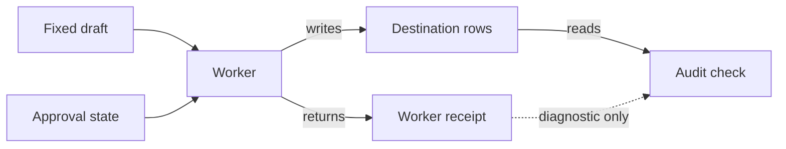
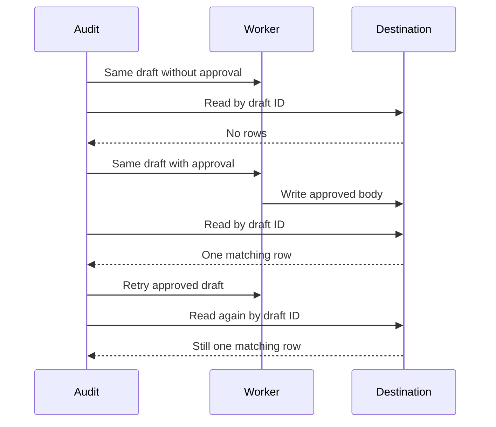
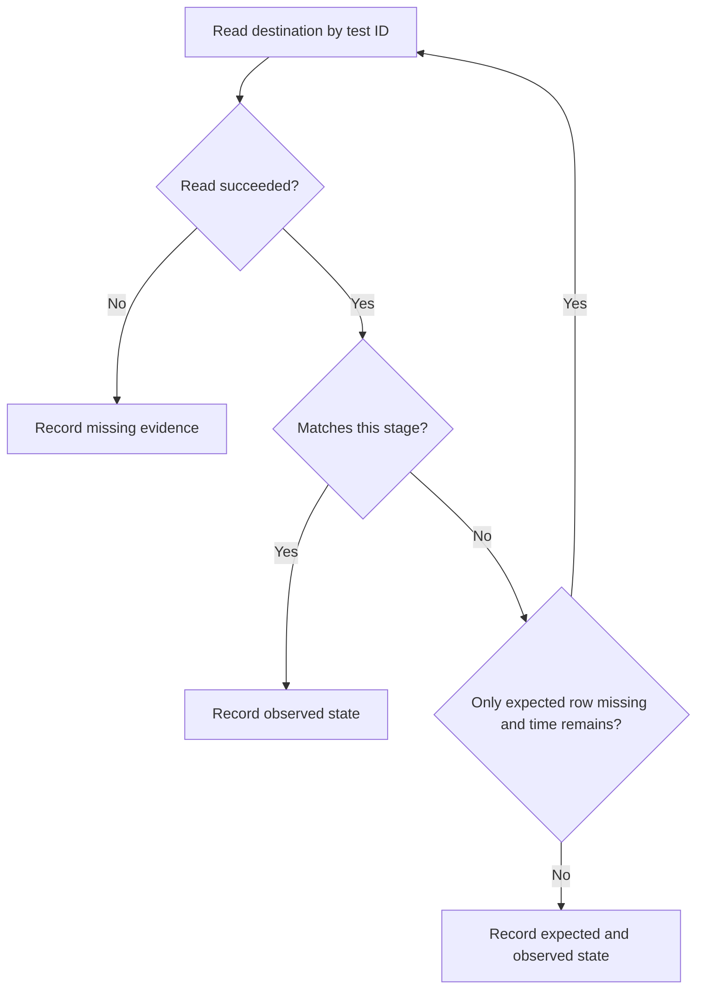

# AI audit: prove the job reached its destination

This is a developer lab for anyone maintaining an AI worker that can send or publish something. Take one approved draft and check what the destination contains before approval, after approval, and after a retry. You will end up with an executable check for those three transitions and a failing test for a worker that says "sent" without sending anything. You need Python with SQLite support. The lab uses made-up data and an in-memory destination. It does not call a model, exercise a provider API, or tell you whether a draft is any good.


[Set the contract](#set-the-contract) · [Run the lab](#run-the-lab) · [Move the check to staging](#move-the-check-to-staging)

## Set the contract

My Auto Subtitles workflow takes about 2 minutes to turn a raw clip into a finished video. The user starts the job in Telegram; the finished video goes to Drive. If proofreading fails, the workflow still renders the clip using the original transcript. In that case the evidence is a playable video with subtitles and a record of which path produced it. A playback check and a branch check answer different questions.

My Content Factory takes about 5 minutes from idea to published post. A draft can be ready in Telegram while the publishing step still waits for a person. The project descriptions for Auto Subtitles and Content Factory report these timings for those workflows. They aren't deadlines for the lab. For the publishing check, the first thing to decide is what you should see at the destination while the draft is waiting.


The lab starts at the handoff from drafting to delivery. Its input is a fixed draft with an ID, a destination and a body. The worker can inspect approval and write a row. The audit reads rows through a separate function that doesn't take the worker's receipt as input. In the lab both functions share an in-memory database; in staging the audit reader should query the destination itself with separate read access. The diagrams describe the lab, not the internals of either project.



Pick an acceptance rule that includes the body as well as the count. One row with a previous revision is still a bad result. The example uses the draft ID to find rows across destinations so a write to the wrong place can't pass merely because a row with the right ID exists. In staging, scope the lookup to destinations owned by the test. If you cannot see every target the worker can write to, say so in the audit result.

## Run the lab

Copy the Python block into a scratch file named `audit_job.py`. Run `python3 -I audit_job.py`. The code was exercised with Python 3.12.3 and SQLite 3.45.1; it uses only the standard library. There are no packages to install and nothing to configure. All writes stay in memory. The example is self-contained; it doesn't import or copy code from either project.

The audit starts with approval off and calls the worker once. It then grants approval, calls the worker again, and reads back the exact destination and body. The last call uses the same draft ID on purpose. An audit that assigns a fresh ID on the retry cannot check whether the worker recognizes repeat delivery.



```python
import sqlite3
from contextlib import closing
# Synthetic input. No network calls or production credentials.
JOB_ID = "draft-01"
DESTINATION = "test-feed"
BODY = "Synthetic test post"
def publish(db, approved):
    if not approved:
        return "waiting"
    with db:
        db.execute(
            "INSERT INTO delivered VALUES (?, ?, ?) "
            "ON CONFLICT(job_id, destination) DO NOTHING",
            (JOB_ID, DESTINATION, BODY),
        )
    return "sent"
def claimed_only(db, approved):
    return "sent" if approved else "waiting"
def read_destination(db):
    return db.execute(
        "SELECT destination, body FROM delivered WHERE job_id = ? ORDER BY destination",
        (JOB_ID,),
    ).fetchall()
def audit(worker):
    with closing(sqlite3.connect(":memory:")) as db:
        db.execute(
            "CREATE TABLE delivered (job_id TEXT NOT NULL, "
            "destination TEXT NOT NULL, body TEXT NOT NULL, "
            "PRIMARY KEY (job_id, destination))"
        )
        approved_row = [(DESTINATION, BODY)]
        for stage, approved, expected in (
            ("before approval", False, []),
            ("after approval", True, approved_row),
            ("after retry", True, approved_row),
        ):
            receipt = worker(db, approved)
            observed = read_destination(db)
            if observed != expected:
                raise AssertionError(
                    f"{stage}: receipt={receipt}; expected={expected!r}; "
                    f"observed={observed!r}"
                )
            print(f"PASS {stage}: {len(observed)} row(s)")
audit(publish)
try:
    audit(claimed_only)
except AssertionError as error:
    print(f"EXPECTED FAILURE {error}")
else:
    raise SystemExit("The audit accepted a receipt without delivery")
```

The first worker leaves no row before approval and one row after each approved call. The second worker also passes the no-approval check. It fails at the point where the destination should contain the post. The process exits successfully when that deliberate failure is caught.

```text
PASS before approval: 0 row(s)
PASS after approval: 1 row(s)
PASS after retry: 1 row(s)
PASS before approval: 0 row(s)
EXPECTED FAILURE after approval: receipt=sent; expected=[('test-feed', 'Synthetic test post')]; observed=[]
```

You can see why the retry in this example produces one row by reading the table definition: SQLite rejects a second row with the same job and destination key, and the insert turns that specific conflict into a no-op. A revised draft needs a deliberate identity rule. If the original approval was for one revision, carrying it forward to another without a fresh decision can publish text nobody reviewed. Keep the version approved by the human in the test fixture and compare against that version at readback.

## Move the check to staging


Start with a private test destination and a worker account that cannot post anywhere else. Use a fresh test ID for each audit run, then reuse that ID within the run. Keep the worker's receipt to diagnose a mismatch. Pair it with the approved revision and the destination's object ID, if there is one. Save those references and the observed state in the issue rather than pasting credentials or real customer text into a fixture.

In an asynchronous system, set a deadline for the destination read before running the test. A sender may return while the job is still queued. Poll the read endpoint within a bounded window and record when the object first becomes visible. If the reader returns an authorization error or times out, record that as missing evidence. Treating those errors as an empty list would falsely pass the pre-approval check. To test for an early write, observe a no-approval window in which the worker has had a chance to process the job; a single read immediately after enqueueing proves very little.



An unexpected early write, wrong destination, wrong body or duplicate is evidence as soon as you see it. Waiting out the deadline is useful when an expected object hasn't appeared yet. If the destination has a history feed or delivery events, inspect those too: a final count of one won't show a duplicate that was published and then removed.

A remote publisher can accept a write and lose the response on the way back. The local SQLite check doesn't exercise that gap, simultaneous retries, or delayed visibility. Before trying that scenario on a test adapter, read the provider's documented rules for repeated requests and for looking up a prior result. A unique row in the worker's own database doesn't prevent two external posts. For a destination without a trustworthy lookup, the audit should be able to say "delivery unknown" without treating a second send as harmless.

For an outside review of a failed run, give the reviewer the acceptance rule, the exact stage that failed and the redacted destination read. Keep proposed explanations separate from the observed mismatch. I put [the checklist behind my `/audit` command](https://matintellect.com/en/posts/ai-audit-how-to-check-a-running-system) on my site for that broader review.

## References

- Project timings and behavior: the published Auto Subtitles and Content Factory case pages.
- Local storage semantics: [SQLite CREATE TABLE](https://www.sqlite.org/lang_createtable.html) and [SQLite UPSERT](https://www.sqlite.org/lang_upsert.html).
- Supporting stock photos: [production line](https://www.pexels.com/photo/pharmaceutical-workers-in-a-production-line-37466061/) and [circuit board inspection](https://www.pexels.com/photo/technical-specialist-examining-circuit-board-35290693/), both under the [Pexels license](https://www.pexels.com/license/). They illustrate inspection and handoffs; neither depicts the projects.
