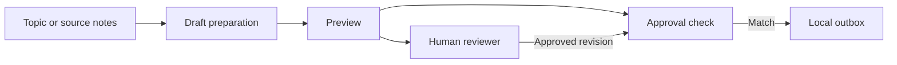
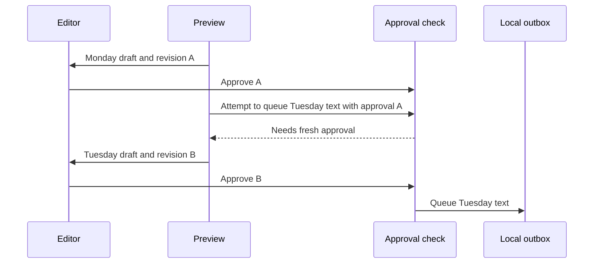
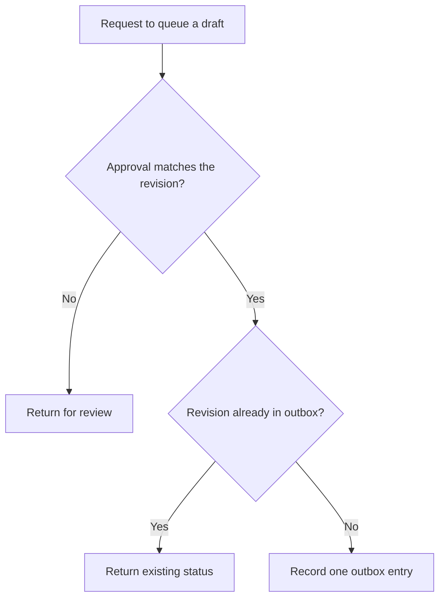

# AI consulting for developers: test the approval step before you build

Engineering note for the developer who has to turn "let AI write our posts" into a first implementation ticket. Start with one draft, one reviewer and one destination. By the end you'll have a test for what happens when a draft changes after someone approves it. The example runs offline with made-up text and an in-memory outbox. It doesn't call a model or publish anything.


[Scope](#choose-the-action-you-need-to-control) · [Architecture](#separate-the-draft-from-the-send) · [Replay](#run-the-local-replay) · [Pilot](#decide-what-to-build-next)

## Choose the action you need to control

In my Content Factory project, I still choose the topic and approve publication. The system prepares the text and image and brings them back for review. The Content Factory case page records about 1 week of development and about 5 minutes from idea to publication in my workflow. That second figure includes the path through approval. It isn't a measure of how long every reviewer will take to respond.

Take a publishing task you've already done and find the step where the outside world first sees the result. Write down what was on screen when the reviewer approved it. Did they see the destination and the image, or only the text? If an editor changed the caption after that, did anyone look at it again? You can answer those questions with one old post and the person who sent it. Use a made-up post in the repo; keep the real material in the system where your team already works.


The first ticket can then say what the team needs to observe: an edited draft needs fresh approval, and a second click on the same approval must not create a second send. If the team can't agree whether a late edit needs review, settle that before designing the button. Otherwise the developer ends up deciding what the editor meant by "approved."

## Separate the draft from the send

Give draft preparation an output it can hand to another component: the exact text for preview. The reviewer sees that text and approves its revision. The approval check compares the approved revision with the proposed send. In the replay, the outbox is just a record of what would have been queued; there is no connection from the outbox to a real account.



You can test this boundary with a hard-coded draft. The draft preparer doesn't need an account that can publish. If you later add an actual publisher, keep its credentials with the publisher and give it only the approved payload. That also makes it possible to run a trial without having to trust a test flag on a live send path.


The useful replay changes the draft between the preview and the attempt to queue it. Think of a date correction. The new text may be better, but the reviewer hasn't seen it. If the button only points to a draft ID and the handler fetches the latest text, the queue can get a different post from the one on screen.



## Run the local replay

Use Python 3.12. The snippet was tested on 3.12.3 in an isolated environment without network access. It uses only the standard library. Copy the code into `approval_replay.py` in a scratch directory and run `python3 -I -B approval_replay.py` with your Python 3.12 interpreter. Use the sample text as written; you don't need to copy a customer record, set a token or install a package. The snippet is original teaching code, with no borrowed project code.

```python
from hashlib import sha256

def revision(text):
    return sha256(text.encode("utf-8")).hexdigest()

def queue(text, approved_revision, outbox):
    current_revision = revision(text)
    if approved_revision != current_revision:
        return "needs fresh approval"
    if current_revision in outbox:
        return "already queued"
    outbox[current_revision] = text
    return "queued"

before = "The workshop starts Monday."
after = "The workshop starts Tuesday."
outbox = {}
first_approval = revision(before)
second_approval = revision(after)

for text, approval in [
    (after, None),
    (after, first_approval),
    (after, second_approval),
    (after, second_approval),
]:
    print(queue(text, approval, outbox))

assert outbox == {second_approval: after}
print("outbox entries:", len(outbox))
```

Expected output:

```text
needs fresh approval
needs fresh approval
queued
already queued
outbox entries: 1
```



The hash here identifies text. It doesn't tell you who approved it. A caller can compute the same hash without reviewing anything, so in an application the server must record approval from an authenticated reviewer who has permission for that destination. Bind the record to the post, destination and the exact text and media shown in the preview. Otherwise a changed image could pass the text comparison. Keep the approved snapshot available to the sender instead of reconstructing it from whatever happens to be current when the job runs.

The dictionary only demonstrates a repeat within one run, for one draft and one destination. Using the text hash alone as a permanent deduplication key would block a legitimate second post with identical copy. For a real queue, enforce uniqueness for the intended send in persistent storage. A timeout after sending needs its own handling: the provider may already have accepted the post. Use a provider idempotency key where supported, or reconcile an uncertain send before retrying it. A local outbox entry by itself can't tell you what the provider did.

## Decide what to build next

For a pilot, replay a few past drafts in private and keep the real destinations disconnected. Include a factual correction after approval and a repeat approval. Ask the actual reviewer to compare the preview with the queued copy. Check whether they can tell why a draft came back and whether they have enough information to approve it again without asking a developer to read the logs.

If the workflow passes those checks, measure two things separately in the pilot: time spent actively editing or reviewing and elapsed time from draft to approval. A draft that takes seconds to produce can still sit until the reviewer comes back. If the wait accounts for most of the delay, work out who reviews and when before spending time tuning the generator.

For the conversation before that first ticket, I put [the AI consulting questions and an interview skill for working through them](https://matintellect.com/en/posts/ai-consulting-before-you-build) in the site article. The timing figures above come from my Content Factory case. The diagrams and replay describe the teaching example, not the project's production internals. Stock photos are by RDNE Stock project and Christina Morillo, used under the [Pexels License](https://www.pexels.com/license/).
