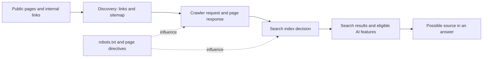
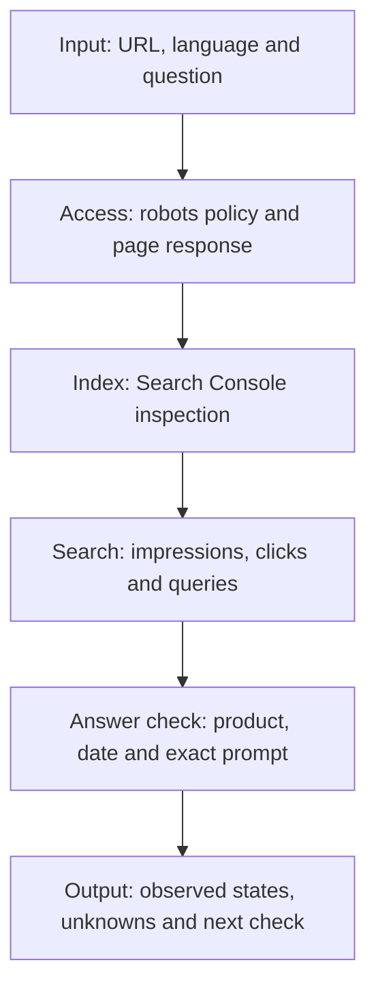

# AI SEO: a practical audit for search and AI answer visibility

This Markdown field guide is for developers and site owners who need to diagnose why a public page is hard to find in search or absent from AI answers. The result is a set of separate observations about access, indexing, search performance and citations. It does not predict rankings, prove a crawler visited a page, or guarantee that an AI product will cite it.

People find information through both search engines and AI answers. I account for both when promoting my own platforms. My [article on AI SEO, GEO and AEO](https://matintellect.com/en/posts/ai-seo-search-and-ai-answers) explains the broader approach; this guide turns it into an audit you can run for one URL.

## Navigation

- [How the pieces fit](#how-the-pieces-fit)
- [Audit one URL](#audit-one-url)
- [Record an observation](#record-an-observation)
- [Interpret the results](#interpret-the-results)
- [References](#references)

## How the pieces fit

A sitemap and internal links help search systems discover URLs. A crawler requests a URL subject to its access rules and the site's response. The search system then decides whether to index the page. An answer product may use a search result as a source, but access and indexing do not ensure selection.

The following is a conceptual architecture diagram. It describes stages to investigate, not a claim that all search or AI products implement the same pipeline:

GEO means generative engine optimization; AEO means answer engine optimization. Both names refer to improving visibility in generated answers. Google says its usual search foundations apply to AI Overviews and AI Mode. A page must be indexed and eligible to appear with a snippet to be considered as a supporting link. That is an eligibility condition, not a promise of inclusion.

## Audit one URL

### 1. Establish the input

Choose a public page and the question it should answer. Record the exact URL, its language and the preferred URL after any redirect. Start with a service page, project page or article whose intended audience and purpose are clear. Inspect the English and Russian versions separately if the site has both: a working version in one language does not establish the state of the other.

Open the page without a logged-in session. Confirm that the relevant information is available as text and that a visitor can reach it through an ordinary internal link. A page behind authentication, or one whose useful information exists only in an image, needs separate attention before you assess search visibility.

### 2. Separate crawler permissions

Read the public `robots.txt` for the host and examine the rules for the specific path. A rule for the homepage does not necessarily apply to a subdirectory. OpenAI documents OAI-SearchBot for search and GPTBot for collecting material that may be used in model training. Their permissions are independent, so decide on each according to the site's policy.

My site's `robots.txt` explicitly allows both. That permission does not prove that either crawler fetched a page or that an answer used it. A failed network request while checking the policy is an unknown state, not evidence of permission or denial. Check server or CDN responses separately, and do not change access restrictions without understanding why they were put in place.

### 3. Check the page response and directives

Inspect the final response after redirects. Note whether the server returns the intended page, whether the text is present and whether the page contains a `noindex` directive. Check response headers for `X-Robots-Tag` as well as robots directives in HTML. A successful robots policy check alone does not tell you what the server returns for the page.

Google's documentation explains how snippet controls affect its AI search features. An intentional `nosnippet` or `noindex` setting may be appropriate for a page, but it also changes what search can show. Record the directive before editing it, and assess the reason for it with the site owner. A blocked request, redirect loop or authentication challenge needs a different fix from a valid page deliberately excluded from the index.

### 4. Inspect discovery and indexed state

Check that the sitemap lists the intended URL and that internal links point to the preferred address. A sitemap is a discovery aid, not a list of guaranteed indexed pages. After a move, verify the redirect from the old address and update internal links instead of relying only on a new sitemap entry.

In Google Search Console, inspect the exact URL. Compare its indexed status with the live test. The live test describes a current fetch; the indexed status concerns what Google has processed. Requesting indexing does not confirm it happened. After a change, revisit the report and keep the dates of both observations.

## Record an observation

Use separate fields for separate states. This example is a template, not a completed audit. The data-flow diagram shows how observations reach a decision; it is not executable code.

For each check, keep:

- The requested URL and final URL, including the language version
- The date and the crawler or product being checked
- The robots policy for the path, plus the actual page response
- Any index or snippet directives found in the response
- The Search Console indexed state and, separately, the live-test result
- The exact question asked in an AI product and whether the answer linked to the page
- Unknowns, errors and the next observation date

Do not turn an untested field into a pass. If Search Console access is unavailable, mark the indexed state unknown. If an AI answer includes no citation, record the observation without assuming that the page was blocked. The same prompt can produce a different answer later, so save its wording and repeat it over time.

## Interpret the results

An accessible page can still be absent from an index. An indexed page can still be absent from a particular answer. Search Console impressions, clicks and queries describe search performance; incoming enquiries describe a different outcome. Google's normal Web search reporting includes traffic from its AI search features, so do not treat that report as a separate count of AI citations.

My AI SEO project records growth to 117 pages in Google's index and a list of 167 search queries for selecting topics. The first figure describes indexed pages; the second describes a planning input. Neither is a count of enquiries or proof of inclusion in an AI answer.

If the page is accessible but the live and indexed states differ, preserve both observations and check again after the change has had time to be processed. If the page is indexed but an answer does not cite it, review whether the page directly answers the question and repeat the observation later. Avoid claiming that a single missing citation identifies the cause.

## References

- [Google Search Central: AI features and your website](https://developers.google.com/search/docs/appearance/ai-features) - eligibility and controls for Google's AI search features
- [OpenAI: overview of OpenAI crawlers](https://developers.openai.com/api/docs/bots) - crawler purposes and user agents
- [Pexels photograph by Leeloo The First](https://www.pexels.com/photo/an-open-notebook-with-notes-7818107/)
- [Pexels photograph by Daniil Komov](https://www.pexels.com/photo/laptop-on-wooden-desk-with-glasses-34803995/)

The diagrams are explanatory examples created for this guide. There is no borrowed executable code or installation requirement.
