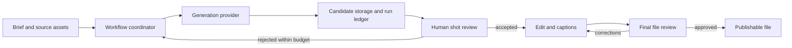
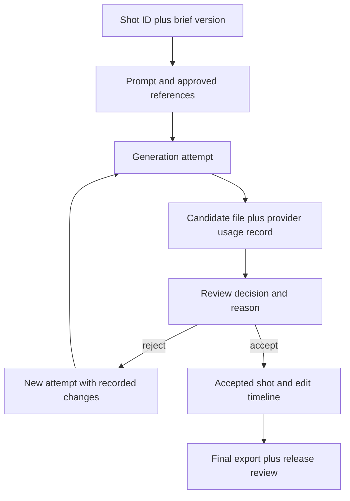
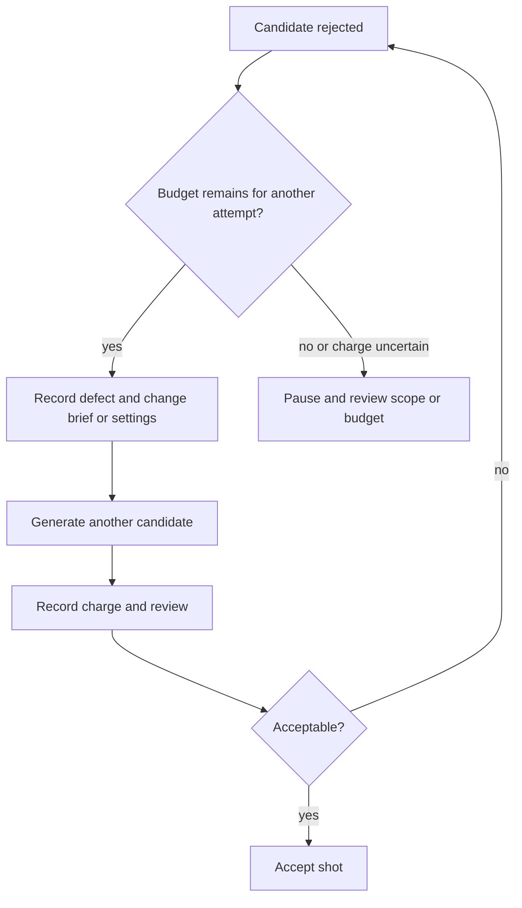

# AI video budget and quality: a developer's workflow

This is a practical design note for developers who need to deliver an AI-assisted video and account for the cost of getting an acceptable result. You will leave with a workflow, a trial ledger and a release checklist. The architecture is an illustrative design, not a production implementation or a benchmark. It does not prescribe a provider, promise a price, or generate a video by itself.

## Start with a small, comparable test

Before integrating an API, write down the audience, publishing destination, aspect ratio, target duration and the message the viewer should understand. Pick one short scene that exposes the hardest requirement: for example, a face speaking a name, a camera move, or a character that must remain recognizable between shots.

Run the same brief and comparable output settings through the candidates you are considering. Keep the prompt, reference material, model and settings with each result. A single attractive sample tells you little about the number of attempts needed for an acceptable shot. Record every attempt, including failed and discarded ones, and compare the cost of the accepted result.

The estimates below are a planning method, not a prediction of a provider's invoice. Check current pricing, billing increments, subscription limits, download charges and commercial-use terms before committing money. If a trial is included in a subscription, record its allocation separately so that a nominal zero charge is not confused with a zero resource cost.

## Architecture: where generation ends and review begins

The diagram shows a proposed workflow. A person owns the brief and accepts or rejects each shot. The generation service produces candidate media; storage keeps candidates and their metadata; the editor assembles accepted material; the final review checks the actual exported file.

For a one-off project, the coordinator can simply be a person using a spreadsheet and a provider's interface. An API becomes useful when the same steps genuinely repeat. Treat the diagram as a boundary map, not evidence that this particular system is already deployed.

Store credentials outside the repository and restrict access to source footage and generated files. A reference image, voice sample or script may contain personal or confidential information. Obtain the person's consent before creating a likeness or copying their voice, and check the provider's retention and usage terms before upload. Avoid putting private assets in a public issue or demo repository.

## Follow the data and keep the history

Each shot needs a stable identifier. Associate it with the brief version and each generation attempt so that a later edit does not make the cost ledger impossible to understand. Keep original files and accepted exports distinct: overwriting the source makes corrections and audit difficult.

At minimum, capture the shot ID, attempt number, model, settings, timestamp, provider-reported usage or charge, reviewer decision and file location. Record the reason for rejection in plain language: a mispronounced name requires a different correction from a broken hand or a framing problem. Keep sensitive prompts and file paths in a protected store rather than exposing them in public logs.

## Estimate the cost of an accepted shot

For each attempt, use the actual provider charge when available. Add all attempts for the same shot, including failed requests if the provider billed them. Then add the cost of audio, avatar use, editing, captions and export where applicable. Do not assume that a published per-second rate includes all of these items.

A hypothetical example: a shot has three billed attempts at $0.40 each. The third is accepted, so generation for that shot totals $1.20, not $0.40. If an editor later changes the brief and needs a fourth attempt, add that charge to the same shot's history. This example uses invented prices solely to illustrate the calculation; it is not a quote or a measured result.

A spending cap needs an operational response. Before each new attempt, check the remaining allowance against the provider's billing rules. If the next charge is uncertain, stop and review the account or ask the person responsible for the budget. A local estimate cannot guarantee a hard cap unless the provider or billing account actually enforces one. Leave a separate contingency for changes after a first review and account for the time a person spends editing.

Avoid retrying a paid request blindly after a timeout. The provider may have accepted it even if the client never received a response. Check the job status and billing record first; use the provider's documented idempotency mechanism if one is available. Rate limits, queue delays and incomplete downloads also need distinct handling: repeating a download is not the same action as starting a new generation.

## A real example of a different part of the pipeline

In my [automatic subtitles project](https://matintellect.com/en/projects/auto-subtitles), a finished subtitled video takes about 2 minutes instead of half an hour of manual work. I built the assistant in 1 day. Those figures describe processing an existing recording, not the speed or cost of generating AI video.

The input is a video placed in Google Drive and a Telegram command. The assistant transcribes the speech with word timing, proofreads the text, adds subtitles and returns the result to Drive. If proofreading fails, the project can still produce a video with the original transcription. It also reports failures and reuses transcription when reprocessing. Those details are useful when planning the post-production stage, but they do not establish that the illustrative generation workflow above shares its implementation.

## Review the export, not just the preview

A reviewer needs the original brief and the final file side by side. Check names and factual claims against the approved script, then watch faces, hands, transitions and lip sync. Listen for pronunciation and the balance between speech and music. A generated scene can look convincing and still say a name incorrectly.

Watch the final export on a phone and once without sound. Captions and essential text should remain readable, and important details should not sit under the destination platform's controls. Confirm that the export uses the intended aspect ratio and that the actual file, not an older preview, is the one approved for release.

For an avatar, review the likeness and voice using material the person has agreed to provide. Consent is a prerequisite, not a quality test. Keep a record of the agreed use and check whether the output and source assets can be used in the intended commercial context.

## Sources and reuse

The generation workflow and three diagrams are illustrative and contain no borrowed code. They are a design aid rather than an executable example. The case details come from the linked project page above. Photos are by [Abdulkadir Emiroğlu](https://www.pexels.com/photo/video-editing-software-interface-close-up-29505140/) and [Amar Preciado](https://www.pexels.com/photo/computer-and-a-laptop-with-editing-software-11063289/), used under the [Pexels license](https://www.pexels.com/license/). The cover is from the associated site article.

The diagrams use GitHub's [Mermaid support](https://docs.github.com/en/get-started/writing-on-github/working-with-advanced-formatting/creating-diagrams). If the renderer does not display them, the diagram source still describes the decisions and data flow. A repository README can link to this note by its actual relative path once the publishing location is known; see GitHub's [README documentation](https://docs.github.com/en/repositories/managing-your-repositorys-settings-and-features/customizing-your-repository/about-readmes).
