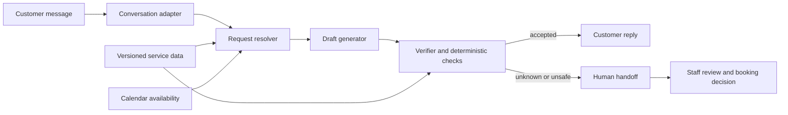
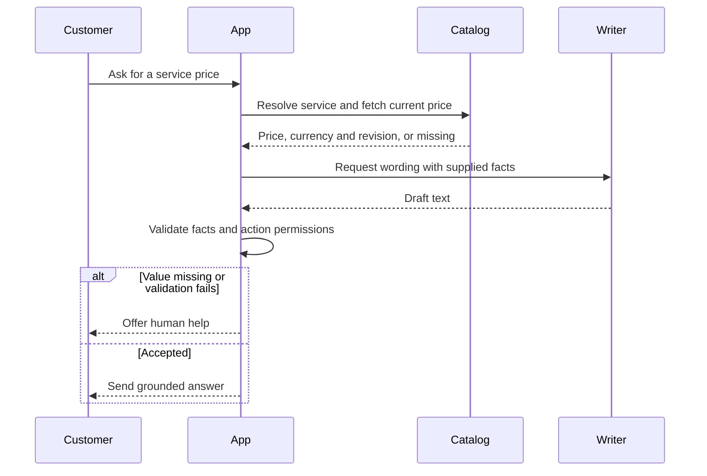
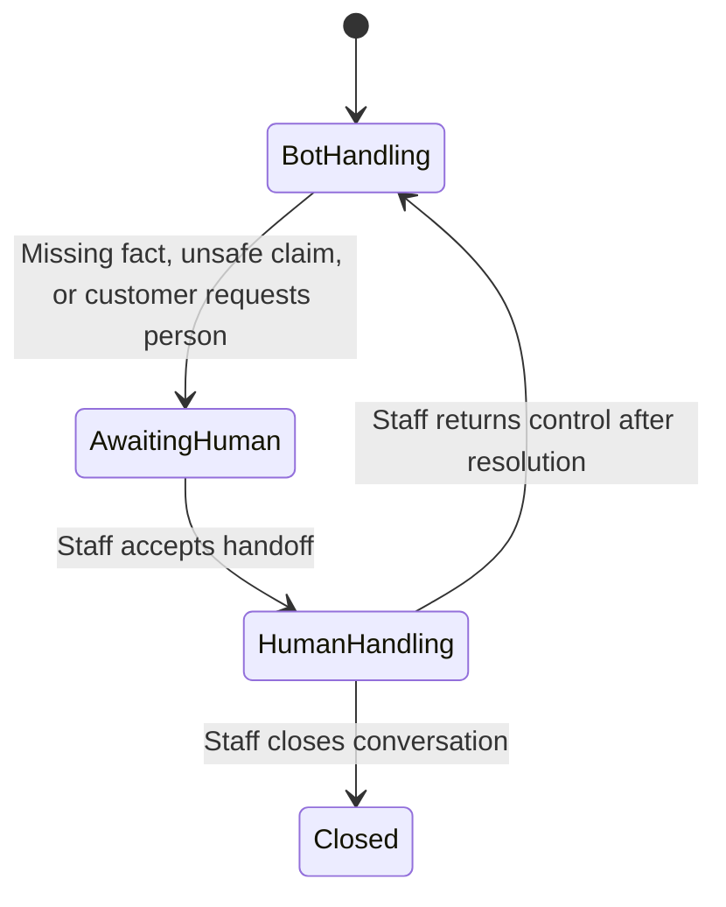

# Make an AI receptionist sound human: a developer's guide

This is a technical design note for developers building a text receptionist for a small business. The task is to answer a customer's actual question without inventing prices or treating a suggested appointment as a confirmed booking. The result is a proposed architecture and a small, runnable local test of its price boundary. It is not a complete receptionist, a voice system, or a production booking integration.


## Contents

- [The problem and the real project](#the-problem-and-the-real-project)
- [Architecture and data flow](#architecture-and-data-flow)
- [Run a local price-boundary test](#run-a-local-price-boundary-test)
- [Handoff and failure cases](#handoff-and-failure-cases)
- [Sources and image credits](#sources-and-image-credits)

## The problem and the real project

A customer asks, "How much is the consultation?" A receptionist that begins a new questionnaire instead of answering has already made the conversation harder. A friendly phrase cannot repair a wrong price either. The answer needs two things: an appropriate conversational response and a source for any factual claim.

I built an AI receptionist for a clinic whose owner was handling repeated Instagram questions. Its knowledge base covers about 114 price items and 48 services. The system draws prices, dates and the address from the clinic's documents and calendar. A second AI checks claims against clinic material; unanswered questions go to the owner. The owner confirms the booking. The system was tested on real questions and is ready to be enabled when the owner decides. Those figures describe the scope of the knowledge base, not a conversion or accuracy measurement.

The design below is a teaching model, not a copy of that clinic's code or a claim about its exact implementation. It separates drafting from the program that decides what the customer can see. A model's response, including a checker's response, is input to a decision, not proof that a price is current.

## Architecture and data flow



The adapter associates the incoming message with the right conversation. The resolver finds the requested service in the current approved data and obtains availability from the calendar if the customer asked for it. The draft generator can make the wording natural and use relevant conversation context. The verifier compares claims with the retrieved evidence. The final program applies explicit rules before any reply is sent.

Give the draft generator structured facts, not a long, unversioned dump of messages. For example, the input may include a service identifier, a price value, its currency and the revision of the price list. An absent value must stay absent. If a service is known but the price is missing, the safe output is a request for staff help rather than a guessed figure.


A useful boundary is to keep the value outside the model's prose until rendering. In the following illustrative flow, the program owns the price. The generator may provide a greeting or wording, but it does not decide the number.



A second model can catch a mismatch or a promise that a receptionist should not make, but it can miss errors itself. For prices, compare structured values in code against the current approved data. For appointment slots, query the calendar; a past message saying a slot was free is not a reservation. The owner or authorized staff member must confirm a booking before the customer is told it is confirmed.

My article on [making an AI receptionist sound human](https://matintellect.com/en/posts/make-an-ai-receptionist-sound-human) also includes a Humanizer skill for reviewing wording. The checks in this note cover a different concern: whether a value is allowed to reach the customer at all.

## Run a local price-boundary test

The example below uses Python 3.14.9 and only the standard library. Save it as `price_check.py` in a scratch directory and run `python3 price_check.py`. It reads no files, opens no network connections, and uses fictional service data. It tests price equality, an updated price, a missing value and an unknown service. The program's dictionary stands in for a trusted catalog; it is not a calendar, model or database.

```python
from decimal import Decimal

def validate_price(service, proposed, catalog):
    if service not in catalog or catalog[service] is None:
        return "handoff"
    try:
        return "accept" if Decimal(proposed) == Decimal(catalog[service]) else "handoff"
    except (TypeError, ValueError, ArithmeticError):
        return "handoff"

catalog = {"consultation": "120.00", "follow-up": None}
assert validate_price("consultation", "120.00", catalog) == "accept"
assert validate_price("consultation", "90.00", catalog) == "handoff"
assert validate_price("follow-up", "50.00", catalog) == "handoff"
assert validate_price("unknown", "50.00", catalog) == "handoff"
catalog["consultation"] = "135.00"
assert validate_price("consultation", "120.00", catalog) == "handoff"
assert validate_price("consultation", "135.00", catalog) == "accept"
print("6 price boundary checks passed")
```

Expected output is `6 price boundary checks passed`. If an assertion fails, Python raises an error instead. The update test matters because a previously correct answer becomes unsafe when the underlying catalog changes. In a real implementation, make the comparison against an approved version fetched close to send time; define how to handle a catalog update between verification and delivery.

This toy function takes an already extracted amount. It does not parse arbitrary prose, compare currencies, authenticate catalog changes, or detect a second conflicting amount in a draft. Do not attach it to a customer channel as a production guard. An implementation also needs reliable service resolution, currency validation, input limits and explicit handling of exceptions, timeouts and missing data.

## Handoff and failure cases


Human handoff is a state transition, not a sentence the bot prints and then forgets. Store the reason and enough relevant context for a staff member to act. While the human owns the conversation, prevent automated replies from racing with the staff response. Protect stored messages with access controls and a retention policy appropriate to the business and applicable law.



Several failure paths deserve separate tests:

- An unknown service and a known service with no price must both avoid publishing an amount. Staff can distinguish the two reasons internally.
- A model may give a correct price and an unsupported treatment promise in the same reply. Matching the price alone is insufficient; route unsupported advice or commitments to staff.
- A calendar may be unavailable, stale or change between lookup and staff confirmation. Say that confirmation is pending; do not promise that a suggested slot is booked.
- A checker can time out, disagree or approve a bad draft. Set a bounded retry policy and a human fallback. Never treat a timeout as approval.
- A customer can change the topic or ask for a person halfway through. Preserve relevant context without repeating questions already answered, and provide a real route to staff.

For deployment, add a test dataset of authorized, anonymized conversations and have staff review failures. Track the source revision used for each factual answer, but avoid logging sensitive customer content unless it is needed and authorized. The local checks here establish only the behavior of this example; they do not establish the accuracy or conversational quality of any production agent.

## Sources and image credits

- The clinic details and status are from the linked article above. The architecture diagrams and Python example are original teaching material for this note; no third-party code is copied.
- [Python decimal documentation](https://docs.python.org/3/library/decimal.html) describes decimal arithmetic used in the example. The example deliberately avoids binary floating-point prices.
- [GitHub's diagram documentation](https://docs.github.com/en/get-started/writing-on-github/working-with-advanced-formatting/creating-diagrams) describes Mermaid rendering in Markdown. Rendering depends on the viewer; the diagram source remains readable where Mermaid is unsupported.
- Photos: [Edwin Nava](https://www.pexels.com/photo/person-using-cellphone-in-front-of-a-laptop-4189445/) and [Anna Shvets](https://www.pexels.com/photo/thoughtful-woman-text-messaging-on-smartphone-at-counter-5711945/), via Pexels. The [Pexels license](https://www.pexels.com/license/) permits free use subject to its restrictions, including no implied endorsement by depicted people.
